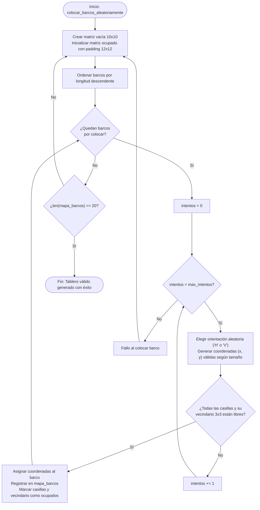
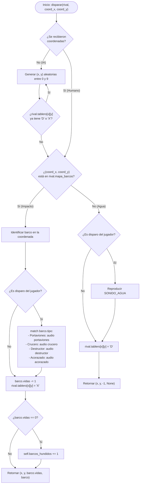
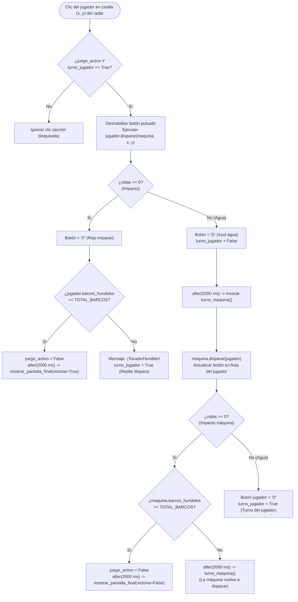
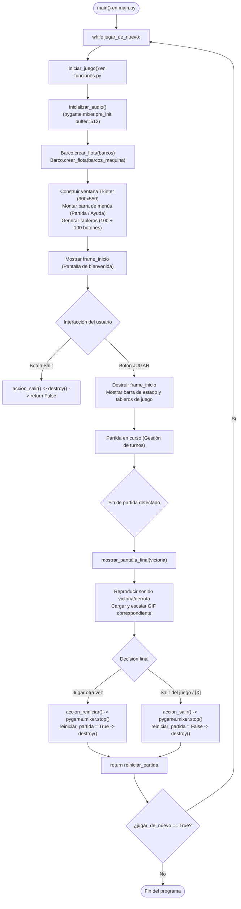

# ⚓ Hundir la Flota (Battleship)

[](https://www.python.org/)
[](https://www.pygame.org/)
[](https://docs.python.org/3/library/tkinter.html)
[](./test/informe_pruebas_hundir_la_flota.md)

Recreación interactiva y moderna del clásico juego de estrategia naval **Hundir la Flota** con interfaz gráfica en **Tkinter**, motor de efectos de sonido con baja latencia mediante **Pygame Mixer**, colocación algorítmica con regla de separación 3x3 y animaciones finales.

---

## 📋 Tabla de Contenidos

1. [Características Principales](#-características-principales)
2. [Estructura del Proyecto](#-estructura-del-proyecto)
3. [Instalación y Ejecución](#-instalación-y-ejecución)
4. [Reglas del Juego](#-reglas-del-juego)
5. [Diagramas de Flujo de las Funciones Clave](#-diagramas-de-flujo-de-las-funciones-clave)
   - [1. Colocación Aleatoria de Barcos (`colocar_barcos_aleatoriamente`)](#1-colocación-aleatoria-de-barcos-colocar_barcos_aleatoriamente)
   - [2. Mecánica de Disparo y Efectos Sonoros (`disparar`)](#2-mecánica-de-disparo-y-efectos-sonoros-disparar)
   - [3. Gestión de Turnos y Ciclo de Disparo (`disparar_jugador` / `turno_maquina`)](#3-gestión-de-turnos-y-ciclo-de-disparo-disparar_jugador--turno_maquina)
   - [4. Ciclo de Vida del Juego y Pantallas (`iniciar_juego`)](#4-ciclo-de-vida-del-juego-y-pantallas-iniciar_juego)
6. [Suite de Pruebas y Cobertura](#-suite-de-pruebas-y-cobertura)

---

## ✨ Características Principales

- **Interfaz Gráfica Moderna:** Diseño en modo oscuro (`#1e293b` / `#0f172a`), con doble tablero de 10x10 (Radar enemigo y Flota propia).
- **Motor de Audio sin Latencia:** Precarga en buffer optimizado (`buffer=512`) con sonidos distintivos por tipo de barco (*Portaviones*, *Crucero*, *Acorazado*, *Destructor*), agua, impactos y fanfarrias de victoria/derrota.
- **Transición de Pantallas Fluida:** 
  - Pantalla inicial de bienvenida con botón interactivo `JUGAR`.
  - Pantalla final integrada con animaciones GIF adaptativas (`subsample`), resultado y botones de revancha inmediata.
- **Gestión Realista de Turnos:** 
  - Pausa de 2 segundos entre disparos (`TIEMPO_ESPERA_TURNO = 2000 ms`).
  - Bloqueo preventivo de clics para evitar acciones indebidas durante el turno enemigo.
  - Regla oficial: **quien impacta, repite disparo**; quien falla, cede el turno.
- **Algoritmo de Colocación Naval 3x3:** Generación procedural que respeta la regla de no-contacto (los barcos no se tocan ni horizontal, ni vertical, ni diagonalmente).
- **Control de Ventana y Salida Segura:** Protocolo `WM_DELETE_WINDOW` para liberación limpia de memoria y detención de audio.

---

## 📁 Estructura del Proyecto

```text
HundirLaFlota/
│
├── main.py                     # Punto de entrada limpio de la aplicación
├── funciones.py                # Lógica de juego, interfaz Tkinter y subsistema de audio
├── variables.py                # Constantes de juego, dimensiones, rutas de assets y paleta de colores
│
├── clases/                     # Clases del modelo de dominio
│   ├── __init__.py             # Exportador de clases
│   ├── barco.py                # Entidad Barco y métodos de fábrica (crear_flota)
│   ├── tablero.py              # Entidad Tablero y generación matricial
│   └── jugador.py              # Entidad Jugador, lógica de disparos, IA y colocación
│
├── assets/                     # Recursos multimedia (audios e imágenes)
│   ├── victoria.mp3 / .gif     # Audio y animación de victoria
│   ├── derrota.mp3 / .gif      # Audio y animación de derrota
│   ├── portaviones.mp3         # Efecto de impacto en Portaviones
│   ├── acorazado.mp3           # Efecto de impacto en Acorazado
│   ├── crucero.mp3             # Efecto de impacto en Crucero
│   ├── destructor.mp3          # Efecto de impacto en Destructor
│   ├── agua.mp3                # Efecto de disparo al agua
│   └── barco_hundido.mp3       # Efecto de barco destruido
│
└── test/                       # Suite de pruebas automatizadas
    ├── test_juego.py           # 43 pruebas unitarias, de integración y de interfaz
    ├── informe_pruebas_hundir_la_flota.md  # Informe técnico en Markdown
    └── informe_pruebas.html    # Informe interactivo con métricas visuales
```

---

## 🚀 Instalación y Ejecución

### 1. Requisitos Previos
- **Sistema Operativo:** Windows 10/11, macOS o Linux.
- **Python:** Versión **3.10 o superior** instalada en el sistema. Puedes comprobarlo ejecutando:
  ```bash
  python --version
  ```
- **Dispositivo de audio:** Altavoces o auriculares habilitados para los efectos de sonido.
- **Tkinter:** Incluido por defecto en Windows y macOS. *(En distribuciones Linux como Ubuntu/Debian se instala con `sudo apt-get install python3-tk`)*.

---

### 2. Clonar el Repositorio
Clona el repositorio desde GitHub o descarga el proyecto en una carpeta local:
```bash
git clone https://github.com/BorjaBG/HundirLaFlota.git
cd HundirLaFlota
```

---

### 3. Crear y Activar un Entorno Virtual (Recomendado)
Para aislar las dependencias del proyecto y evitar conflictos con otros paquetes de Python:

- **En Windows (PowerShell):**
  ```powershell
  python -m venv venv
  .\venv\Scripts\Activate.ps1
  ```
  *(Si PowerShell bloquea la ejecución de scripts por política de seguridad, ejecuta previamente: `Set-ExecutionPolicy -Scope Process -ExecutionPolicy Bypass`)*.

- **En Windows (CMD / Símbolo del sistema):**
  ```cmd
  python -m venv venv
  venv\Scripts\activate.bat
  ```

- **En macOS / Linux:**
  ```bash
  python3 -m venv venv
  source venv/bin/activate
  ```

---

### 4. Instalación de Dependencias
Con el entorno virtual activado, instala los requisitos necesarios mediante el archivo [`requirements.txt`](./requirements.txt):
```bash
pip install -r requirements.txt
```
*(Instalará `pygame>=2.6.0` para la reproducción de efectos sonoros y música)*.

---

### 5. Cómo Ejecutar el Juego
Una vez completados los pasos anteriores, lanza la aplicación ejecutando [main.py](file:///c:/Bootcamp%20Proyectos/HundirLaFlota/main.py):
```bash
python main.py
```
Se abrirá la ventana gráfica de **Hundir la Flota** mostrando la pantalla de bienvenida con el botón **JUGAR**.

---

### 6. Ejecución de la Suite de Pruebas
El proyecto incluye un conjunto de 43 pruebas unitarias y de integración que verifican la integridad de las entidades, la lógica de juego y la interfaz gráfica:

- **Ejecutar todos los tests (modo descubrimiento estándar):**
  ```bash
  python -m unittest discover -s test
  ```

- **Ejecutar con salida detallada por consola:**
  ```bash
  python test/test_juego.py
  ```

- **Visualizar el informe técnico interactivo:**
  Abre directamente el archivo [`test/informe_pruebas.html`](./test/informe_pruebas.html) en tu navegador web preferido (Google Chrome, Microsoft Edge, Firefox, etc.) para consultar las métricas, tiempos de respuesta y desglose por módulo.

---

### 7. Preguntas Frecuentes y Solución de Problemas (Troubleshooting)

<details>
<summary><strong>¿Qué ocurre si ejecuto el juego en un equipo sin tarjeta de sonido o altavoces?</strong></summary>
<p>
El subsistema de audio en <code>funciones.py</code> está encapsulado con bloques <code>try/except</code> seguros. Si el mezclador de Pygame no detecta un dispositivo de audio disponible, el juego continuará funcionando con normalidad sin interrumpir la partida.
</p>
</details>

<details>
<summary><strong>Error: "No module named '_tkinter'" en Linux</strong></summary>
<p>
En algunas distribuciones de Linux, Tkinter no viene preinstalado con el intérprete. Puedes instalarlo con:
<code>sudo apt-get update && sudo apt-get install python3-tk</code>
</p>
</details>

<details>
<summary><strong>¿Puedo reiniciar una partida en curso?</strong></summary>
<p>
Sí, puedes reiniciar en cualquier momento desde la barra de menú superior haciendo clic en <strong>Partida &gt; Nueva partida/Reiniciar</strong>, o bien al finalizar el juego mediante el botón <strong>Jugar otra vez</strong>.
</p>
</details>

---

## 📜 Reglas del Juego

1. Cada flota cuenta con **10 barcos** sumando un total de **20 casillas**:
   - 1 Portaviones (4 casillas)
   - 2 Acorazados (3 casillas cada uno)
   - 3 Cruceros (2 casillas cada uno)
   - 4 Destructores (1 casilla cada uno)
2. Los barcos se posicionan aleatoriamente sin tocarse entre sí (ni ortogonal ni diagonalmente).
3. En tu turno, haz clic sobre una casilla del radar enemigo (tablero derecho):
   - **Tocado (`X`):** Si aciertas a un barco rival, se reproduce su sonido característico y **vuelves a disparar**.
   - **Agua (`D`):** Si disparas al agua, se escucha el chapoteo y tras 2 segundos el turno pasa a la máquina.
4. La máquina responderá disparando automáticamente a casillas no exploradas de tu flota (tablero izquierdo).
5. **Victoria / Derrota:** El primer jugador en hundir la totalidad de los 10 barcos del rival gana la partida.

---

## 📊 Diagramas de Flujo de las Funciones Clave

A continuación se detallan los diagramas de flujo de los 4 procesos más importantes de la aplicación:

### 1. Colocación Aleatoria de Barcos (`colocar_barcos_aleatoriamente`)
*Ubicación:* [`clases/jugador.py`](./clases/jugador.py)  
Se encarga de posicionar los 10 barcos de forma procedural garantizando la separación en vecindario 3x3 sin bloqueos.



---

### 2. Mecánica de Disparo y Efectos Sonoros (`disparar`)
*Ubicación:* [`clases/jugador.py`](./clases/jugador.py)  
Gestiona el impacto sobre el rival, la actualización del estado de vidas, el conteo de barcos hundidos y la reproducción sonora por tipo de navío.



---

### 3. Gestión de Turnos y Ciclo de Disparo (`disparar_jugador` / `turno_maquina`)
*Ubicación:* [`funciones.py`](./funciones.py)  
Orquesta la alternancia entre el usuario y la computadora, el bloqueo de clics y las condiciones de victoria o derrota.



---

### 4. Ciclo de Vida del Juego y Pantallas (`iniciar_juego`)
*Ubicación:* [`main.py`](./main.py) y [`funciones.py`](./funciones.py)  
Estructura de ejecución general de la aplicación, transiciones entre menús y reinicio de partidas.



---

## 🧪 Suite de Pruebas y Cobertura

El proyecto cuenta con una cobertura de pruebas exhaustiva implementada en [`test/test_juego.py`](./test/test_juego.py):

| Módulo de Prueba | Cantidad | Aspectos Validados |
| :--- | :---: | :--- |
| **`TestVariables`** | 9 | Consistencia de barcos, IDs únicos, suma de casillas (20), existencia de assets `.mp3`/`.gif` y paleta de colores `#RRGGBB`. |
| **`TestTablero`** | 4 | Dimensiones 10x10 con `DIMENSION_TABLERO`, celdas de agua y total independencia de memoria entre filas. |
| **`TestBarco`** | 5 | Propiedades, decremento de vidas, mutación de coordenadas y factorías `crear_desde_diccionario` y `crear_flota`. |
| **`TestJugadorColocacion`** | 4 | 20 casillas por jugador, ocultamiento de flota enemiga, coordenadas en rango [0..9] y regla de no-contacto 3x3. |
| **`TestJugadorDisparos`** | 6 | Disparo sobre agua/barco, incremento de bajas, descarte de casillas repetidas y ejecución de sonidos según tipo de barco. |
| **`TestFuncionesJuego`** | 2 | Retorno del mezclador de audio de baja latencia y submuestreo adaptativo `subsample(2, 2)` de GIFs. |
| **`TestEstresYSimulacion`** | 2 | 50 generaciones continuas de tableros sin bloqueos y 10 partidas simuladas completas hasta el final. |
| **`TestInterfazGrafica`** | 11 | Menús, widgets, pantalla de bienvenida, pantalla final, bloqueo de turnos, repetición en acierto y protocolo `WM_DELETE_WINDOW`. |
| **Total** | **43** | **100% Superadas con éxito** |

Para más detalles, consulta el [Informe Técnico de Pruebas en Markdown](./test/informe_pruebas_hundir_la_flota.md) o visualiza el [Informe Interactivo en HTML](./test/informe_pruebas.html).

---

## 👤 Autor

Desarrollado para el Bootcamp de Programación — Proyecto **Hundir la Flota**.
